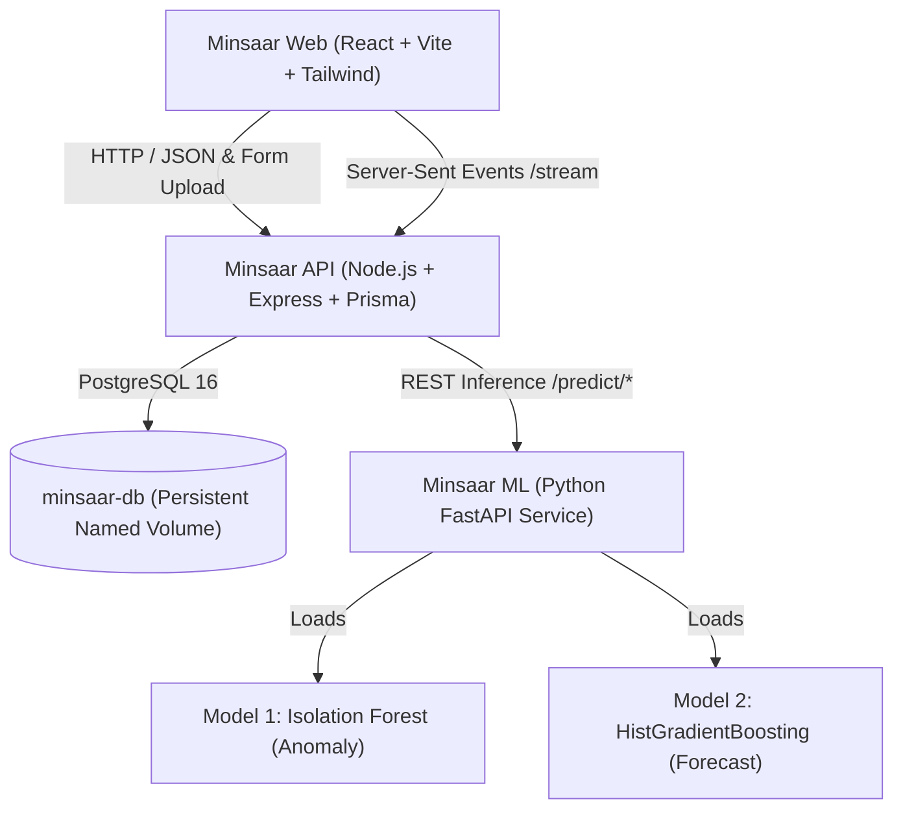

# Minsaar: AI-Powered Hall-Level AC Energy Optimization System

Minsaar is an intelligent, hall-level air conditioning (AC) energy optimization platform for academic campuses. It integrates machine learning anomaly detection, multi-horizon electricity consumption forecasting, and a rule-based HVAC control engine to reduce phantom power waste, maintain thermal comfort, and optimize scheduled campus operations.

---

## 1. System Architecture



The system consists of four isolated services:
1. **Frontend (`minsaar/client`)**: React 18, Vite, TypeScript, Tailwind CSS, Framer Motion, Recharts.
2. **Backend API (`minsaar/server`)**: Node.js 20, Express, TypeScript, Prisma ORM, PostgreSQL 16, Zod, JWT cookies, node-cron.
3. **ML Service (`minsaar/ml_service`)**: Python FastAPI loading trained scikit-learn models for anomaly detection and multi-horizon forecasting.
4. **Database (`postgres:16-alpine`)**: Persistent named volume `minsaar_postgres_data` surviving container rebuilds and restarts.

---

## 2. Quick Start with Docker Compose

To start the entire stack:

```bash
# 1. Build and start all services
docker compose up -d --build

# 2. View status
docker compose ps

# 3. View live logs
docker compose logs -f api
```

The services will be accessible at:
- **Web Dashboard**: [http://localhost:8080](http://localhost:8080)
- **Node Backend API**: [http://localhost:3000/api](http://localhost:3000/api)
- **ML Inference Service**: [http://localhost:5001](http://localhost:5001)
- **PostgreSQL Database**: `localhost:5434` (mapped on host to prevent port conflicts)

### Default Login Credentials
- **Admin**: `admin@campus.edu` / `password123`
- **Viewer**: `viewer@campus.edu` / `password123`

---

## 3. Simulation Tab: Benchmark Demonstration

The system comes pre-bundled with a complete one-week synthetic telemetry and operating schedule benchmark package in `minsaar/synthetic_data/`:

1. **Telemetry File (`synthetic_demo.csv`)**:
   - 50,400 rows of 1-minute telemetry across 5 campus halls (`HALL_A` through `HALL_E`) from Nov 1 to Nov 7, 2026.
   - Contains power (`whole_hall_power_kw`, `ac_power_kw`), outdoor temperature, indoor temperature, occupancy, and observed AC states.
2. **Schedule File (`weekly_schedule.csv`)**:
   - Operating schedule for Nov 8 to Nov 14, 2026.
   - Closed on Sunday; extended operating sessions on Tuesday and Friday.

### Running a Simulation in the UI:
1. Log in with `admin@campus.edu` / `password123`.
2. Navigate to the **Simulation** tab.
3. Drag & drop `minsaar/synthetic_data/synthetic_demo.csv` into the **Readings Telemetry** dropzone.
4. Drag & drop `minsaar/synthetic_data/weekly_schedule.csv` into the **Weekly Schedule** dropzone.
5. Click **Start Simulation**.
6. Watch real-time interval steps, energy comparisons (Actual vs Predicted), anomaly detections, and estimated savings persist directly to the PostgreSQL database!

---

## 4. Machine Learning Integration & Limitations

### Model 1: Electricity Usage Anomaly Detection
- **Pipeline**: `IsolationForest` pipeline (`SimpleImputer` + `StandardScaler` + `IsolationForest`).
- **Features**: Exact 8 numeric features (`meter_reading`, `air_temperature`, `dew_temperature`, `hour_of_day`, `day_of_week`, `month`, `is_weekend`, `square_feet`).
- **Cadence**: Hourly aggregated electricity consumption.
- **Limitation Note**: Model 1 was trained on ASHRAE building-level data. When applied to hall-level telemetry, outputs represent simulated proxies for demonstration rather than field-validated submeter accuracy.

### Model 2: Energy Forecasting
- **Pipeline**: `HistGradientBoostingRegressor` with recursive roll-forward feature generator.
- **Requirement**: Minimum 168 hours of continuous historical readings to initialize lag and rolling features.
- **Horizons**: 2H, 24H, 3D (72H), 7D (168H).
- **Limitation Note**: Forecaster predictions represent building-level proxy demand estimates. All savings calculations are executed by the rule-based controller.

---

## 5. Database Persistence & Safeguards

- Data is permanently stored inside the named Docker volume `minsaar_postgres_data`.
- Running `docker compose down` and `docker compose up -d` **preserves all database records**.
- **Important**: Never run destructive commands like `docker compose down -v` or `docker volume prune` in production, as those explicitly discard named volumes.

### Verified Persistence Check:
```bash
# 1. Stop containers
docker compose down

# 2. Restart containers
docker compose up -d

# 3. Check record count
docker exec -it minsaar-db psql -U postgres minsaar -c "SELECT count(*) FROM simulation_jobs;"
```

---

## 6. Testing

### Run All Backend Tests:
```bash
cd minsaar/server
npm test
```
*Current test suite: 33 passing tests across auth, structure, schedules, temperature, settings, ingestion, rule engine, and simulation lifecycle.*

### Run All Frontend Tests:
```bash
cd minsaar/client
npx vitest run
```
*Current test suite: 9 passing tests across CSV validation, energy calculations, and mock store.*

---

## 7. License

Academic / Campus Demonstration — Copyright (c) 2026 Minsaar Team.
